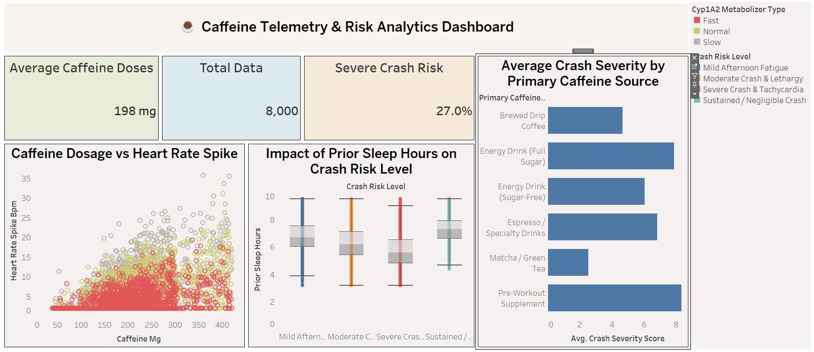

# Analisis Telemetri Kafein, Risiko Crash, dan Tingkat Kecemasan

[](https://www.python.org/)
[](https://www.sqlite.org/)
[](https://www.tableau.com/)

Proyek analisis data *end-to-end* yang mengkaji dampak fisiologis konsumsi kafein, profil metabolisme genetika (CYP1A2), pola tidur, serta korelasi langsungnya terhadap penurunan energi mendadak (*energy crash*) dan skor kecemasan akut.

---

## Tujuan Analisis (*Project Objectives*)
Proyek ini dirancang untuk menjawab beberapa pertanyaan kunci bagi konsumen dan industri kesehatan/kebugaran:
1. **Mengidentifikasi Faktor Risiko Utama:** Mengetahui variabel mana (dosis, sumber kafein, atau durasi tidur) yang paling dominan memicu *Severe Crash & Tachycardia*.
2. **Evaluasi Profil Genetika:** Membuktikan secara kuantitatif bagaimana variasi enzim metabolisme CYP1A2 mempengaruhi kecepatan tubuh dalam memproses kafein.
3. **Analisis Dampak Sampingan:** Mengukur korelasi antara asupan kafein, intensitas rasa gelisah (*jitters*), dan tingkat kecemasan akut.
4. **Penyediaan Rekomendasi Praktis:** Membangun dasar analitis bagi konsumen untuk mengoptimalkan konsumsi kafein harian tanpa mengorbankan produktivitas atau kesehatan fisik.

---

## Ringkasan Proyek
Kafein adalah zat psikoaktif yang paling banyak dikonsumsi di seluruh dunia, namun toleransi fisiologis setiap individu sangat bervariasi. Proyek ini menganalisis **8.000 data telemetri konsumen** untuk mengungkap pola tersembunyi di balik *caffeine crash*, lonjakan detak jantung (*heart rate spike*), dan tingkat kecemasan.

Menggunakan *tech stack* 3-tools yang profesional, proyek ini mencakup:
1. **Python (Google Colab):** Inspeksi data, verifikasi kualitas data (bebas *missing value* dan duplikat), serta *Exploratory Data Analysis* (EDA).
2. **SQL (DBeaver / SQLite):** Manajemen database relasional, agregasi data, dan penulisan *query* analitis bisnis.
3. **Tableau:** Perancangan *executive dashboard* interaktif untuk *data storytelling*.

---

## Detail Wawasan & Temuan Analitis (*Detailed Insights*)

- **1. Pengaruh Genetik CYP1A2 terhadap Waktu Onset *Crash*:**
  * *Slow Metabolizers* mengalami penurunan energi (*crash*) jauh lebih cepat, yakni rata-rata dalam **3.92 jam**, disertai skor kecemasan akut yang lebih tinggi (**5.42**).
  * Sebaliknya, *Fast Metabolizers* memiliki ketahanan yang jauh lebih stabil dengan waktu *crash* rata-rata mencapai **7.16 jam** dan skor kecemasan yang rendah (**2.55**).
- **2. Risiko Berdasarkan Sumber Kafein:**
  * *Pre-Workout Supplement* mencatatkan rata-rata dosis kafein tertinggi (~336 mg), lonjakan detak jantung paling ekstrem (~9.31 BPM), dan tingkat keparahan *crash* tertinggi (~8.31), menjadikannya produk yang paling berisiko bagi individu sensitif.
  * *Brewed Drip Coffee* dan *Matcha / Green Tea* menunjukkan profil risiko yang jauh lebih aman dengan tingkat keparahan *crash* di bawah 4.6.
- **3. Peran Krusial Waktu Tidur sebagai Faktor Pelindung (*Protective Factor*):**
  * Pengguna yang mengalami kategori risiko terparah (*Severe Crash & Tachycardia*) memiliki durasi tidur malam sebelumnya yang lebih rendah secara signifikan (rata-rata **5.66 jam**).
  * Pengguna dengan kategori stabil atau *Sustained / Negligible Crash* rata-rata memiliki waktu tidur yang mencukupi (di atas **7.3 jam**).
- **4. Korelasi Kuat antara Jitters dan Kecemasan:**
  * Berdasarkan matriks korelasi, terdapat hubungan linier yang sangat kuat ($r = 0.87$) antara intensitas rasa gelisah (`jitters_intensity_score`) dan skor kecemasan akut (`acute_anxiety_score`), mengindikasikan bahwa gejala fisik berupa gemetar akibat kafein langsung memicu respons kecemasan psikologis.

---

## *Tech Stack* & Metodologi

### 1. Inspeksi & Eksplorasi Data (Python)
- Melakukan verifikasi struktur data: **0 *missing values***, **0 duplikat**, dan rentang nilai ekstrem yang valid secara logis.
- Menghasilkan visualisasi distribusi, *box plot*, *scatter plot* (dosis vs. detak jantung), dan matriks korelasi menggunakan pustaka `Seaborn` dan `Matplotlib`.

### 2. Manajemen Basis Data & SQL Querying (DBeaver)
- Memuat dataset bersih ke dalam basis data relasional.
- Mengeksekusi *query* agregasi (`GROUP BY`, `AVG`, `COUNT`) untuk mengekstrak metrik bisnis penting berdasarkan sumber kafein, tipe metabolizer, dan tingkat risiko.

### 3. Executive Dashboard (Tableau)
- Merancang *one-page interactive executive dashboard* yang memuat kartu KPI, peringkat risiko sumber kafein, dan distribusi dampak fisiologis.

---

##  Tampilan & Akses Dashboard Tableau
*Executive dashboard* interaktif dirancang untuk menyajikan ringkasan metrik utama (*KPI cards*, korelasi dosis vs detak jantung, distribusi durasi tidur, dan tingkat keparahan berdasarkan produk) dalam satu halaman (*one-pager*).

* **File Tableau (*.twbx):** Tersedia di folder `dashboard/caffeine_telemetry_dashboard.twbx`
* **Live Interactive Dashboard:** [https://public.tableau.com/app/profile/username/viz/caffeine-telemetry-dashboard)](https://public.tableau.com/app/profile/muhammad.yusril.arjuliio.prayitno/viz/Caffeine_Analysis/Dashboard1#1)

*(Pratinjau tampilan dashboard)*  


---

## Struktur Repositori Proyek

```text
caffeine-telemetry-portfolio/
│
├── data/
│   └── caffeine_crash_and_anxiety_telemetry.csv
├── notebooks/
│   └── exploratory_data_analysis.ipynb
├── sql/
│   └── caffeine_telemetry_analysis.sql
├── dashboard/
│   ├── caffeine_telemetry_dashboard.twbx
│   └── tableau_dashboard_preview.png
└── README.md
